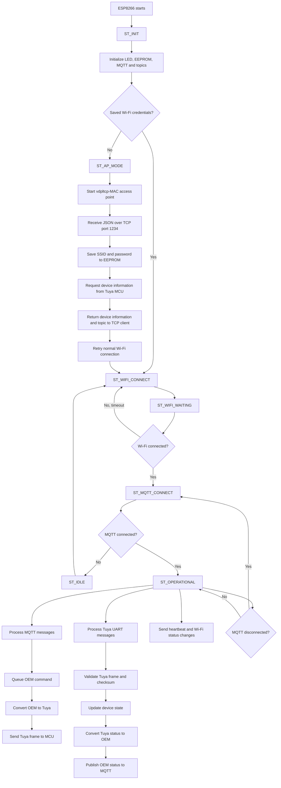

# Tuya Middleware Bridge

This project is an ESP8266-based middleware bridge between a Tuya MCU and an
OEM controller/cloud service. It translates messages between the Tuya serial
protocol and the OEM protocol, while providing Wi-Fi provisioning, MQTT
communication, persistent configuration, status reporting, and an OTA update
path.

The code is written for the Arduino ESP8266 environment. The `.ino` files in
[`main/`](main/) are compiled together as one Arduino sketch.

## What has been developed on this branch

The `develop` branch currently contains the following development work:

- Added the main ESP8266 middleware application and its state-machine-based
  runtime.
- Added Tuya UART frame reception, header/length synchronisation, checksum
  validation, and reset-command handling.
- Added conversion from Tuya MCU messages to OEM controller messages.
- Added conversion from OEM commands to Tuya MCU messages.
- Added support for four switches and one fan, including fan power and speed.
- Added complete/all-node status generation and status query handling.
- Added MQTT connection, subscription, publishing, and inbound message
  queuing.
- Added MAC-address-based MQTT topic generation.
- Added EEPROM persistence for Wi-Fi credentials.
- Added Wi-Fi station connection and retry handling.
- Added access-point provisioning mode with a TCP configuration endpoint.
- Added Wi-Fi/MQTT heartbeat and status reporting to the Tuya MCU.
- Added reset handling that clears stored credentials and restarts the device.
- Added backlight and child-lock support.
- Added an OTA update flow using the configured update URL.
- Updated the firmware version used by the OTA request to `1.4.0`.

## High-level architecture

The ESP8266 is the bridge between three interfaces:

1. **Tuya MCU over UART**
   Uses frames beginning with `55 AA`. The MCU reports device state and
   receives control commands.
2. **OEM controller over the OEM message format**
   Uses frames beginning with `{` (`0x7B`) and ending with `}` (`0x7D`).
3. **MQTT cloud/application**
   Receives converted OEM status messages and sends OEM control messages.

The shared device state is stored in `TuyaDeviceState` in
[`main/constant.h`](main/constant.h). It contains switch, fan, backlight,
child-lock, and restart-status values. Conversion code updates this structure
before generating outgoing messages.

## Runtime flow

The following diagram shows the normal boot, provisioning, connection, and
message-processing flow.



## Message conversion flow

### Tuya MCU to MQTT

1. [`processSerialInput()`](main/SerialHandler.ino) reads bytes from the
   serial port.
2. The parser synchronises on `55 AA`, reads the payload length, and waits for
   the complete frame.
3. The Tuya checksum is calculated and compared with the received checksum.
4. Reset commands are handled separately by clearing EEPROM and restarting.
5. [`TuyaToOem()`](main/ProtocolConversion.ino) interprets the command and
   data point (DPID).
6. [`updateDeviceState()`](main/SerialHandler.ino) updates the shared device
   state.
7. The corresponding OEM status frame is published to the generated MQTT
   publish topic.

### MQTT/OEM to Tuya MCU

1. [`mqttCallback()`](main/MqttHandler.ino) receives an MQTT payload and adds
   it to the message queue.
2. The main loop removes queued messages at a controlled rate.
3. [`OemToTuya()`](main/ProtocolConversion.ino) validates the OEM frame and
   creates a Tuya command frame.
4. The Tuya checksum is appended.
5. The frame is written to the MCU over UART.

All-node status requests can create several queued OEM update frames. The
queue prevents inbound MQTT commands from blocking the main loop.

## State machine

The state machine is implemented in
[`main/StateMachine.ino`](main/StateMachine.ino).

| State | Responsibility |
| --- | --- |
| `ST_INIT` | Initialise hardware, EEPROM, MQTT, and MQTT topics. |
| `ST_LOAD_CONFIG` | Load saved Wi-Fi credentials from EEPROM. |
| `ST_AP_MODE` | Start the provisioning access point and TCP configuration server. |
| `ST_WIFI_CONNECT` | Start a station-mode Wi-Fi connection. |
| `ST_WIFI_WAITING` | Wait for Wi-Fi or retry after the configured timeout. |
| `ST_MQTT_CONNECT` | Connect and subscribe to the MQTT topic. |
| `ST_OPERATIONAL` | Process MQTT, UART, heartbeat, and status traffic. |
| `ST_OTA_CHECK` | Check whether an OTA update should be performed. |
| `ST_OTA_PERFORM` | Download and apply the firmware update. |
| `ST_IDLE` | Wait before retrying the connection sequence. |
| `ST_ERROR` | Reserved for error-state handling. |

The heartbeat/status byte is also reported to the Tuya MCU whenever the
connection state changes.

## Supported device data

The current DPID mapping is defined in
[`main/constant.h`](main/constant.h):

| Feature | DPID | Direction |
| --- | ---: | --- |
| Switch 1 | `0x01` | Status and control |
| Switch 2 | `0x02` | Status and control |
| Switch 3 | `0x03` | Status and control |
| Switch 4 | `0x04` | Status and control |
| Backlight | `0x10` | Status and control |
| Child lock | `0x65` | Status and control |
| Fan power | `0x66` | Status and control |
| Fan speed | `0x68` | Status and control |
| Restart status | `0x0E` | Status |

Fan speed is translated between the Tuya value representation and the OEM
0–100-style range used by the controller.

## Project structure

| File | Purpose |
| --- | --- |
| [`main/main.ino`](main/main.ino) | Arduino `setup()`, main loop, heartbeat, and message queue draining. |
| [`main/constant.h`](main/constant.h) | Protocol constants, DPIDs, configuration, state structures, and global values. |
| [`main/StateMachine.ino`](main/StateMachine.ino) | Boot, Wi-Fi, MQTT, operational, retry, and OTA state transitions. |
| [`main/SerialHandler.ino`](main/SerialHandler.ino) | UART parsing, checksum validation, state updates, and frame transmission. |
| [`main/ProtocolConversion.ino`](main/ProtocolConversion.ino) | Tuya-to-OEM and OEM-to-Tuya conversion logic. |
| [`main/MqttHandler.ino`](main/MqttHandler.ino) | MQTT client setup, connection, subscription, callback, and publishing. |
| [`main/network.ino`](main/network.ino) | Wi-Fi station/AP mode, MQTT topic generation, and TCP provisioning. |
| [`main/storage.ino`](main/storage.ino) | EEPROM initialisation, credential loading, saving, and clearing. |
| [`main/OtaManager.ino`](main/OtaManager.ino) | OTA client setup, update check, and firmware update execution. |

## Getting started

### Hardware and software

- ESP8266 NodeMCU (the existing build targets `esp8266.esp8266.nodemcuv2`).
- Tuya MCU connected to the ESP8266 UART using the correct voltage levels.
- Arduino IDE with the ESP8266 board package, or an equivalent Arduino build
  environment.
- Required libraries:
  - `ESP8266WiFi`
  - `ArduinoJson`
  - `PubSubClient`
  - `EEPROM`
  - `ESP8266HTTPClient`
  - `ESP8266httpUpdate`
  - `WiFiClientSecure`

### Build and upload

1. Open the `main` folder as an Arduino sketch.
2. Select an ESP8266 NodeMCU board.
3. Select the correct serial port.
4. Build and upload the sketch.
5. Open the serial monitor at `9600` baud.

The sketch is currently organised for Arduino's multi-file `.ino` build
behaviour. Keep the files in the same `main` folder when compiling.

### First-time provisioning

When no credentials are found in EEPROM:

1. The device starts an access point named `vdpltcp_<MAC>`.
2. Connect to that access point. The configured AP password is
   `12345678`.
3. Send a JSON object to the device at TCP port `1234`:

   ```json
   {
     "ssid": "your-wifi-name",
     "password": "your-wifi-password"
   }
   ```

4. The device saves the credentials to EEPROM and continues with station-mode
   Wi-Fi and MQTT connection.

The AP uses `192.168.4.1` as its address. The provisioning implementation is
in [`main/network.ino`](main/network.ino).

## Configuration points

The main deployment values are in
[`main/constant.h`](main/constant.h):

- `MQTT_BROKER` and `MQTT_PORT`
- `mqtt_username` and `mqtt_password`
- `OTA_URL`
- `CURRENT_VERSION`
- `WIFI_TIMEOUT_MS`
- `MQTT_RETRY_MS`
- `TCP_PORT`
- EEPROM addresses and size
- `DEBUG_BAUD`

To enable diagnostic serial output, uncomment `#define DEBUG` in
[`main/main.ino`](main/main.ino). Do not expose production MQTT credentials or
the AP provisioning password in public deployments.

## Current implementation notes

- The OTA state path is present and `performUpdate()` uses
  `OTA_URL` and `CURRENT_VERSION`. The current `checkForUpdates()` function is
  a placeholder that returns `true`, so production update policy should be
  completed before relying on automatic update checks.
- MQTT topics are derived from the device MAC address in
  [`main/network.ino`](main/network.ino). Confirm the deployed topic naming
  convention with the cloud service before integrating a new device.
- The MQTT message queue is intentionally bounded to avoid unbounded memory
  growth. Messages received after the queue limit is reached are not added.
- The current source contains an existing generated `main/build/` directory
  from a local ESP8266 build. Build outputs should not be treated as source
  files when preparing a clean deployment.

## Troubleshooting

| Symptom | First checks |
| --- | --- |
| Device remains in AP mode | Check the JSON field names, TCP port `1234`, and EEPROM write/reset behaviour. |
| Wi-Fi repeatedly reconnects | Confirm SSID/password and the `WIFI_TIMEOUT_MS` setting. |
| MQTT does not connect | Confirm broker address, port, credentials, generated topics, and network reachability. |
| Commands are ignored | Check the OEM start/end bytes, DPID mapping, serial wiring, and checksum. |
| No useful serial diagnostics | Confirm the monitor is set to `9600` baud and enable `DEBUG`. |
| Status is not published | Confirm MQTT connectivity and that the incoming Tuya state actually changed. |
